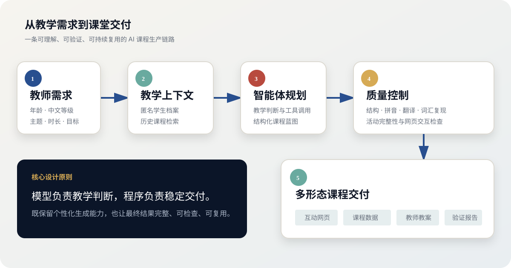

# AI 中文教学智能体

> 将教师的一句话需求，转化为可以直接进入课堂的互动课程。

[在线体验精选课件](https://chloe6723.github.io/chloe-ai-teaching-agent-portfolio/)　·　[查看系统架构](docs/architecture.svg)



## 项目概览

这是我围绕真实中文教学场景设计的一套 **AI 课程生产与交付工作流**。教师输入学生年龄、中文水平、学习目标和课堂时长后，系统会结合学生档案与历史课程，生成结构化课程方案，并自动输出可交互网页、教师教案和质量检查报告。

项目关注的不是“让 AI 写一份教案”，而是让生成结果能够真正进入课堂：内容符合学生水平，活动之间前后衔接，页面可以直接操作，教师能够继续修改和复用。

## 我解决的问题

| 教学中的实际问题 | 系统能力 | 最终交付 |
|---|---|---|
| 同一主题面对不同年龄和水平时，课程不能直接复用 | 读取学生画像并调整语言难度、活动方式和辅助语言 | 个性化课程方案 |
| AI 生成内容容易零散，缺少完整教学链路 | 使用结构化课程模型约束知识输入、操练、语境应用和输出 | 连贯的课堂流程 |
| 教案与课堂展示分离，教师仍需重新制作课件 | 自动渲染响应式互动网页 | 可直接打开的课堂课件 |
| 图片、拼音、翻译和题目容易遗漏 | 自动执行内容完整性与教学质量检查 | 可核验的交付报告 |
| 学生基础和课程版本难以持续管理 | 维护匿名学生档案与课程元数据 | 可复用的课程资产库 |

## 我的工作

- 设计中文教学智能体的课程生成逻辑和完整交付链路
- 建立覆盖知识卡、操练游戏、分级阅读和讨论输出的课程结构
- 将教学经验转化为可执行的结构化数据与质量规则
- 设计并实现适合线上课堂的互动网页
- 整理匿名学生档案、课程索引和版本管理方式
- 对生成结果进行教学、交互、视觉和技术验证

## 项目成果

| 维度 | 成果 |
|---|---|
| 课程覆盖 | 从零基础拼音到 HSK 5 专业话题 |
| 课程资产 | 完成 15 套互动课件的持续迭代 |
| 公开案例 | 精选 3 套具有代表性的最终版本 |
| 交付形式 | 互动网页、结构化课程数据、教师教案、验证报告 |
| 自动验证 | 6 项核心测试全部通过 |
| 隐私处理 | 公开版仅使用虚构学生信息，不包含真实课堂资料 |

## 精选案例

### 01｜四课时中文拼音课

**对象：** 零基础成人学习者

**设计重点：** 将单韵母、声母、韵母和整体认读音节拆分为四个可切换课时，加入专业发音材料、英语近似音提示、听辨活动和情境练习。

**体现能力：** 长课程规划、音频交互、分阶段复习、双语信息设计。

[打开互动课件](lessons/00-pre-hsk/pinyin-four-courses/index.html)

### 02｜第一次去海底捞

**对象：** HSK 2–3、以实际生活和旅行为目标的学习者

**设计重点：** 按取号、入座、点菜、用餐和结账的真实流程组织语言，让词汇、服务表达和角色扮演形成完整任务。

**体现能力：** 场景化课程设计、真实任务拆解、品牌信息核验、课堂角色扮演。

[打开互动课件](lessons/04-hsk2-3/haidilao-restaurant/index.html)

### 03｜中文短视频创作课

**对象：** 希望用中文制作内容的社交媒体创作者

**设计重点：** 围绕镜头表达、脚本结构、口语排练和内容策划，帮助学习者完成一段可以直接拍摄的中文视频。

**体现能力：** 职业需求定制、内容创作工作流、交互阅读、语言输出设计。

[打开互动课件](lessons/04-hsk2-3/social-media-creator/index.html)

## 系统设计

系统由五个阶段组成：

1. **需求解析：** 接收年龄、等级、主题、课堂形式和时长。
2. **教学上下文：** 读取匿名学生档案，检索已确认的课程资产。
3. **智能体规划：** 完成教学判断并生成结构化课程蓝图。
4. **质量控制：** 检查课程结构、拼音、翻译、词汇复现和活动完整度。
5. **多形态交付：** 输出互动网页、课程数据、教师教案和验证报告。

## 技术实现

`Python` · `OpenAI Agents SDK` · `Pydantic` · `HTML / CSS / JavaScript` · `Git / GitHub Pages`

公开仓库保留了结构化数据模型、工具调用框架、网页渲染器、质量验证器、测试和三个最终课件。生产环境的完整提示词、教学规则、真实学生档案与全部课程资产继续保存在私有仓库。

## 测试结果

```text
课程结构约束                         通过
课程质量验证                         通过
互动网页组件                         通过
中文主题文件路径                     通过
课程检索逻辑                         通过
智能体结构化输出                     通过

6 项测试全部通过
```

## 仓库结构

```text
chloe_agent/     智能体框架、数据模型、渲染与验证
data/            虚构学生样例
examples/        结构化课程样例
lessons/         三套精选互动课件
tests/           核心功能测试
docs/            系统架构图
```

本项目为求职展示版本。Copyright © 2026 Chloe Chen. 保留所有权利。
